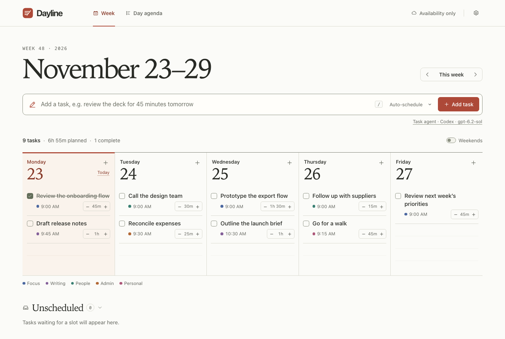

# Dayline

Dayline finds time for your to-do list. Write a task in plain English and it estimates the work, checks your selected Google calendars, and finds an opening within your working hours. The weekly board shows each task under its date. Open a day to see its time blocks alongside your meetings’ busy periods. The Mac app and its local browser view share one planner.



## Install on a Mac

1. Sign in to GitHub with access to the Antaia repository. For an Apple silicon or Intel Mac running macOS 13 or later, download **Dayline-1.2.0-mac-universal.zip**. [Latest Mac release](https://github.com/antaia-space/dayline/releases/latest)
2. Unzip the download, drag **Dayline.app** to **Applications**, and open it. To use the same planner in your browser, choose **File → Open in Browser** in the Mac app. Both views follow your system’s light or dark appearance.

The internal build uses an ad hoc signature and has not been notarized by Apple. If your Mac’s launch policy requires approval, follow Antaia’s approved procedure or run the app from source below.

## Connect your calendars

1. Open **Settings → Calendars**. If prompted, get Antaia’s Google Desktop OAuth client JSON from your Workspace administrator and select **Choose client file**. [Google Calendar setup for administrators](#google-calendar-setup)
2. Leave **Calendar access** on **Check availability only**. Choose **Connect Google account** and approve access in your browser. You can connect more than one eligible account.
3. **Check for conflicts on** starts with all available calendars selected, including shared calendars. Google’s generated Week Numbers feed has no bookable events and is omitted. Keep at least one availability calendar selected and choose **Save calendars**. In availability-only mode, you can uncheck any calendar, including your primary.
4. In **Settings → Working hours**, set your days, hours, and time zone. The default is Monday–Friday, 09:00–17:00, in the Mac’s time zone.

Availability-only is the default for new installations and for planners upgraded from 1.0. Dayline reads calendar names and busy intervals. Task blocks, checkmarks, and deletions stay on your Mac. If a meeting takes a time you had planned to use, the next refresh moves the unfinished task to another opening. If Google cannot confirm availability, upcoming tasks wait under **Unscheduled** until a refresh succeeds. Choose **Refresh availability** to retry. After an internal Mac update, macOS may ask for access to **Dayline Safe Storage** in Keychain. Allow that item in the system dialog and refresh. You can keep capturing and estimating tasks while calendar access is waiting.

### Google Calendar setup

A Workspace administrator sets this up once for Antaia. In an organization-owned Google Cloud project, enable the Google Calendar API. Configure the Google Auth Platform branding and choose the **Internal** audience. Create an OAuth client of type **Desktop app**, download its JSON, and distribute that file through Antaia’s internal channels. Each teammate authorizes their own account on their own Mac. [Enable the API](https://developers.google.com/workspace/guides/enable-apis) · [Configure the consent screen](https://developers.google.com/workspace/guides/configure-oauth-consent) · [Create desktop credentials](https://developers.google.com/workspace/guides/create-credentials#desktop-app)

An Internal client accepts accounts in the Google Workspace organization that owns it. To include a personal calendar, you can share its free/busy availability with your work account and select it in Dayline. Each additional sign-in must be eligible for the chosen OAuth client.

For an **External** client in **Testing**, open **Google Auth Platform → Audience → Test users → Add users**. Add the exact addresses you will connect, save, and start a fresh sign-in from Dayline for each one. Google expires the calendar authorization after seven days in this mode. [Google’s OAuth token guidance](https://developers.google.com/identity/protocols/oauth2#expiration)

To distribute a build with the company’s Desktop client already configured, set the environment variable `DAYLINE_GOOGLE_CLIENT_FILE` to the JSON file’s local path when running the Mac packaging command. Each teammate still signs in to Google. Keep the downloaded file out of source control.

## Plan a task

- **“Draft a proposal by Friday”** lets Dayline estimate the duration and choose an opening before the deadline. **“Call Morgan for 20 minutes tomorrow afternoon”** sets the duration and narrows the search to tomorrow afternoon.
- In **Day agenda**, a task without a date in its text uses the day you are viewing. Choose a date in the entry field to pin the task to that day, or choose **Auto-schedule** to let Dayline find the next opening. The date and text stay with your draft if you reload while the estimate is running.
- Each task type has a consistent color. Select a task to see how its duration was estimated or edit its text, duration, type, or preferred day. If there is no opening long enough, the task appears under **Unscheduled**.
- You can start using the planner before connecting a calendar. It finds time within your work hours and around your other tasks. After you connect, it also checks for conflicts with meetings.

### Choose a task agent

New planners start with **OpenAI via Codex**, set to **gpt-6.2-sol** with **low** reasoning effort. Select the agent shown beside task entry to change it. Existing planners keep their saved choice. For offline planning, choose **Local on this Mac**. It uses Apple Foundation Models on compatible Macs with Apple Intelligence available, or built-in rules.

To connect a subscription, select a provider. Install its official client if prompted, choose **Sign in in Terminal**, then **Check sign-in**. If the client is already signed in on this Mac, Dayline can use that session.

| Agent | Account to use in the official client |
| --- | --- |
| OpenAI via Codex | Run `codex login` and choose **Sign in with ChatGPT** using an account with Codex access. [Codex CLI](https://developers.openai.com/codex/cli/) |
| Google Gemini | For an individual Google AI Pro or Ultra account, start Antigravity CLI with `agy` and choose personal Google OAuth. Eligible organization accounts can also use the legacy Gemini CLI by starting `gemini` and choosing **Login with Google** under `/auth`. [Antigravity sign-in](https://antigravity.google/docs/cli/install/) · [Gemini CLI sign-in](https://geminicli.com/docs/get-started/authentication/) · [Google’s migration notice](https://developers.google.com/gemini-code-assist/docs/deprecations/code-assist-individuals) |
| Anthropic via Claude Code | Run `claude auth login --claudeai` and sign in with the Claude subscription that includes Claude Code. [Claude Code authentication](https://code.claude.com/docs/en/authentication) |

Codex defaults to `gpt-6.2-sol` with **low** reasoning effort. For Google or Anthropic, leave **Model** blank to use the client’s default. You can also choose a suggestion or enter a model ID supported by your account. Choose **Save agent** to apply it. Each estimate sends the task text, local date and time, time zone, and working hours to the selected provider. Calendar availability and placement stay on the Mac. Usage draws on the same account quota as the official client, subject to the provider’s limits and any extra usage you enabled there. Dayline uses subscription sign-in and never switches to API-key billing.

**Last estimate** shows the source, model, Codex reasoning effort, and token counts when available. The account area shows plan and quota details when the client supplies them. If the selected remote agent is offline, out of quota, or returns an unusable estimate, the task stays **Unscheduled** with **Awaiting estimate** and the reason. Open the task and choose **Retry estimate** to request one new estimate from the currently selected agent. Dayline retries only when you ask. Older tasks estimated by a local fallback retain that history and can also be retried. An explicit duration in the task takes precedence. [Shared estimation instructions](src/agents/instructions.md)

### Put tasks on Google Calendar

1. In **Settings → Calendars**, choose **Sync tasks as calendar events**, then **Enable event syncing**. Reconnect the destination account if prompted, and approve event access in Google. Choose a writable **Calendar for new tasks** and save. Dayline always checks that calendar for conflicts.
2. The next successful sync can publish upcoming, unfinished tasks as events. Google receives their titles, times, category colors, and completion state. Tick a task in Dayline to mark its linked event with ✓. From Google Calendar, add ✓ to either end of an event title, or open **Mark complete** in the event description and confirm on the Mac running Dayline. Remove the title’s ✓ or uncheck the task to reopen it.
3. **Sync now** retries pending changes. Dayline checks the event version before updating or deleting it so it can reconcile edits made in Google Calendar. Confirming **Delete task** also removes its linked event while event syncing is enabled. To pause calendar writes, switch back to **Check availability only** and confirm **Use availability only**. Existing Google events stay in your calendar.

Closing the Mac window keeps Dayline running and checking Google about once a minute. After quitting, reopen Dayline to catch up. The planner lives in `~/Library/Application Support/Dayline`. The desktop app protects Google credentials with macOS Keychain-backed encryption.

## Run from source

With Node.js 22.13 or later and access to the private repository, run these commands on your Mac.

```sh
git clone https://github.com/antaia-space/dayline.git
cd dayline
npm ci
npm start
```

| Command | Result |
| --- | --- |
| `npm test` | Run the automated tests. |
| `npm run package:mac` | Build the universal Mac application. |
| `npm run dev` | Start the browser-only development server. Open the single-use URL printed in the terminal. |

The app and **File → Open in Browser** share the desktop profile on loopback port 43127. The development server runs on `127.0.0.1:43128` and stores its separate profile in `~/Library/Application Support/Dayline Development`.
